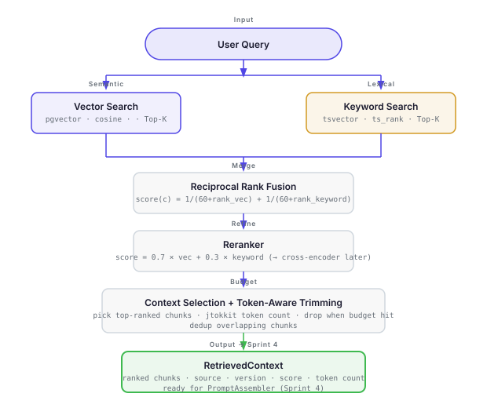

# Sprint 3 — Hybrid Retrieval

## Goal

Build the complete retrieval pipeline — from a user query to a final, trimmed context block
ready to pass to an LLM.

Vector search alone is not enough. Class names, method signatures, and exact API identifiers
are retrieved far better by keyword search. This sprint combines both approaches and then
refines the result through reranking and token-aware context selection.

**Deliverable:** A `RetrievalPipeline` that accepts a query and returns a `RetrievedContext`
object — a ranked, deduplicated, token-budget-respecting list of chunks ready for Sprint 4
(RAG Question Answering).



---

## LLM Fundamentals — Integrated into This Sprint

Learn these before writing any code. Each concept explains a decision you are about to make.

**Embedding model behavior affects retrieval quality**
- *What:* The embedding model defines the vector space. A model trained on general text may not represent Spring AI-specific identifiers (`ChatClient`, `VectorStore`) well. Poor domain fit → vectors for similar concepts land far apart → retrieval misses relevant chunks.
- *Why it matters here:* This is why hybrid retrieval exists. BM25 compensates for embedding model domain gaps on exact identifiers. If retrieval quality is poor despite good chunking, the embedding model is the first thing to investigate.
- *Interview:* "Your vector search returns poor results for API-specific queries. What would you investigate first?"

**Semantic similarity vs lexical matching — when each wins**
- *What:* Vector search excels at conceptual queries ("how does Spring AI handle context?"). Keyword search (PostgreSQL `ts_rank`) excels at exact-match queries ("ChatClient.builder() method"). Neither dominates across all query types. BM25 is the standard algorithm for keyword ranking — what we implement here uses `ts_rank`, which is PostgreSQL's own lexical scorer, not true BM25.
- *Why it matters here:* This is the architectural justification for every line of code in this sprint. If you cannot articulate this, you cannot defend the hybrid retrieval design.
- *Interview:* "Why isn't vector search alone enough? Give a concrete example where keyword search beats semantic search."

**Retrieval quality depends on more than the embedding model**
- *What:* Chunk size, overlap, Top-K value, reranking, and metadata filtering all affect what the LLM receives. A better embedding model cannot compensate for chunks that are too large, a Top-K that is too low, or missing a reranking step.
- *Why it matters here:* When retrieval quality is poor, you need to know which variable to tune. This sprint introduces all the major retrieval levers in one place.
- *Interview:* "How would you systematically improve retrieval quality? What are all the variables you can tune?"

**Precision, recall, and ranking trade-offs**
- *What:* Recall = fraction of relevant chunks retrieved. Precision = fraction of retrieved chunks that are relevant. High Top-K improves recall but degrades precision (more noise for the LLM). Reranking improves precision without sacrificing recall. RRF improves both by combining two recall sources.
- *Why it matters here:* These are the metrics used in Step 3.6 to compare vector-only vs BM25-only vs hybrid results.
- *Interview:* "How do you measure retrieval quality? What is the trade-off between Top-K and precision?"

---

## Why Each Step Exists

| Step | Why it's here |
|---|---|
| Vector search | Captures semantic similarity — "how does Spring AI handle embeddings?" finds relevant chunks even if none of the words appear verbatim |
| BM25 | Captures exact matches — `ChatClient`, `VectorStore`, `EmbeddingModel` are retrieved precisely by keyword |
| RRF | Merges two ranked lists fairly without needing to normalise or compare their scores directly |
| Rerank | Scores the merged candidates by how well each chunk actually answers the query — more expensive but more precise |
| Context selection | Enforces a token budget; picks the highest-ranked chunks that fit within the LLM's context window |

---

## Build Steps

### Step 1 — Flyway V2 migration: add tsvector column

Add a `search_vector` column to `chunks` and a GIN index for fast full-text search.
Also add a trigger to keep `search_vector` updated automatically on insert/update.

```sql
ALTER TABLE chunks ADD COLUMN search_vector tsvector;
CREATE INDEX idx_chunks_search_vector ON chunks USING GIN(search_vector);
UPDATE chunks SET search_vector = to_tsvector('english', content);
```

### Step 2 — KeywordSearchService

PostgreSQL full-text search using `tsvector`, `to_tsquery`, and `ts_rank`.

> **Note:** PostgreSQL's `ts_rank` is **not** BM25. BM25 is a specific probabilistic ranking
> formula (used by Elasticsearch, Lucene). `ts_rank` is PostgreSQL's own coverage-based
> ranking function. Both are lexical ranking approaches, but the scores are not equivalent.
> True BM25 could be added later as a future enhancement.

```java
// SELECT id, content, ..., ts_rank(search_vector, query) AS score
// FROM chunks, to_tsquery('english', ?) query
// WHERE search_vector @@ query
// ORDER BY score DESC LIMIT ?
```

### Step 3 — HybridSearchService (RRF)

Run both searches in parallel. Fuse the two ranked lists using Reciprocal Rank Fusion:

```
RRF score(chunk) = 1/(k + rank_vector) + 1/(k + rank_keyword)
where k = 60  (standard constant)
```

Chunks that appear in both lists get a higher combined score.
Chunks that appear in only one list still get credit for that rank.

### Step 4 — Reranker

Score the fused Top-N candidates by relevance to the original query.
Start with a simple cross-score reranker (score = vector_score × 0.7 + keyword_score × 0.3).
This can be replaced with a Cohere cross-encoder in a later sprint.

### Step 5 — ContextSelector (token-aware trimming)

Given a token budget (e.g. 6,000 tokens for the context window), greedily pick the
highest-ranked chunks until the budget is exhausted. Use jtokkit (already in the project)
to count tokens per chunk.

Output: `RetrievedContext` — an ordered list of chunks with their source, version, score,
and total token count.

### Step 6 — End-to-end comparison

Run 5 test queries. For each, compare:
- Vector-only results (top 5)
- Keyword-only results (top 5)
- Hybrid + reranked results (top 5)

Document where vector wins, where keyword wins, and where hybrid beats both.
This comparison is an interview question in itself.

---

## Classes to Build

| Class | Location | Responsibility |
|---|---|---|
| `KeywordSearchService` | `atlas-retrieval` | PostgreSQL full-text search (`tsvector` / `ts_rank`) |
| `HybridSearchService` | `atlas-retrieval` | RRF fusion of vector + keyword search |
| `Reranker` | `atlas-retrieval` | Score and re-order fused candidates |
| `ContextSelector` | `atlas-retrieval` | Token-aware trimming to fit LLM budget |
| `RetrievedContext` | `atlas-retrieval` | Output value object passed to Sprint 4 |
| `V2__add_search_vector.sql` | `atlas-ingestion` resources | Flyway migration |

---

## Concepts Learned

- Why vector search alone is not enough (the most important retrieval question)
- PostgreSQL keyword search — `tsvector`, GIN index, `to_tsquery`, `ts_rank` (and how this differs from true BM25)
- Reciprocal Rank Fusion — how it works and why k=60
- Reranking — bi-encoder vs cross-encoder, cost vs quality
- Token budgets — why you cannot just dump all retrieved chunks into the prompt
- Context window management
- Retrieval precision vs recall trade-offs

---

## Interview Readiness

After this sprint you must be able to answer these at depth:

**The key question — know this cold:**
> "Why isn't vector search alone enough?"

Vector search finds semantically similar chunks. But it misses exact matches.
If a user asks "how do I use `ChatClient.builder()`", vector search may return
chunks about the ChatClient concept. Keyword search finds chunks that literally contain
`ChatClient.builder`. Hybrid gives you both.

**Other questions:**
- What is BM25? How does it differ from PostgreSQL's `ts_rank`? (BM25 is a probabilistic ranking formula; `ts_rank` is PostgreSQL's coverage-based scorer — both are lexical, but not equivalent. True BM25 is a future enhancement.)
- What is `tsvector`? What does a GIN index do for full-text search?
- What is Reciprocal Rank Fusion? Why k=60?
- What is a reranker? When would you use a cross-encoder instead?
- What is a token budget? Why can't you send all retrieved chunks to the LLM?
- How do you evaluate retrieval quality?
- What is the difference between recall and precision in retrieval?
- How would you tune Top-K?
